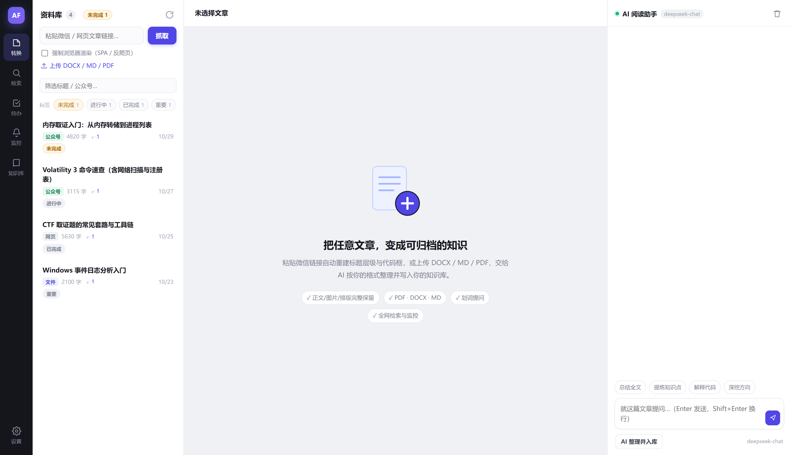
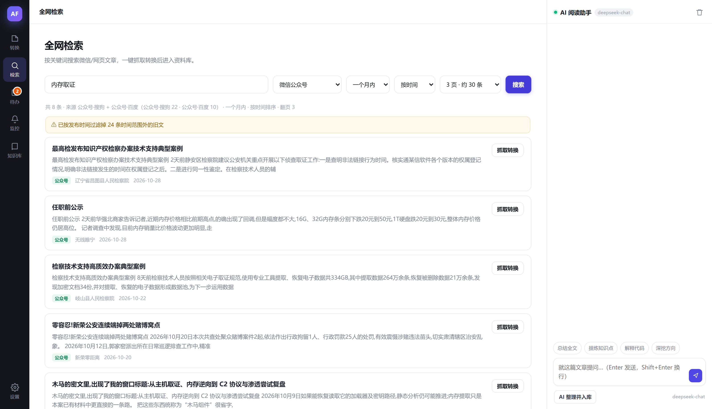
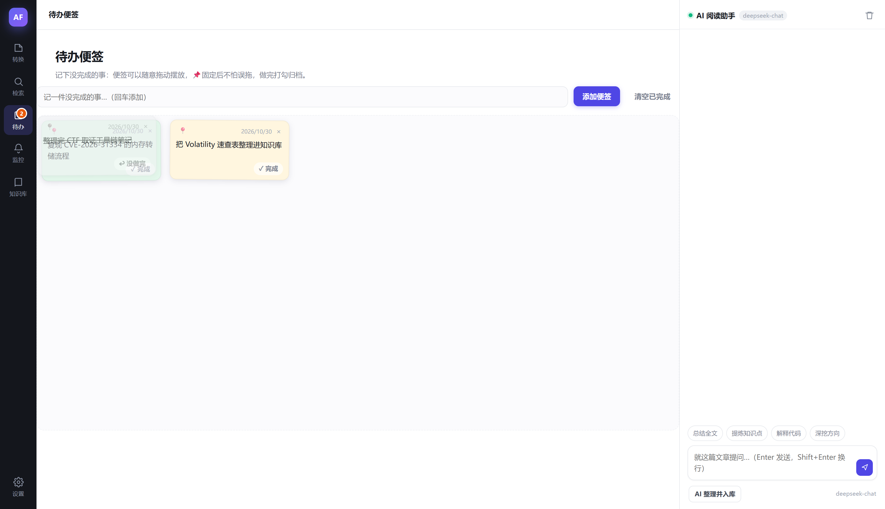
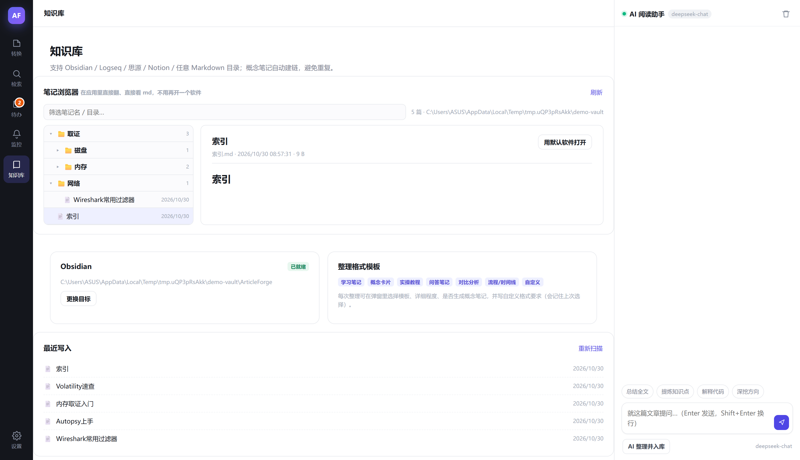

# ArticleForge

Convert web pages, WeChat official account posts and local documents into Markdown, Word or PDF, then let AI reorganize them into knowledge notes and file them into a local knowledge base. Multi-source search and keyword monitoring are included.

A Windows desktop application built with Electron and Node.js. Apart from calls to the AI provider you configure yourself, all processing and data stay on your machine.

[](https://github.com/ilovezerotwo02/ArticleForge/releases/latest)
[](LICENSE)
[](https://github.com/ilovezerotwo02/ArticleForge/releases/latest)



[简体中文](README.md)

## Overview

Saving an article is the easy part; filing it into a personal knowledge system is the real cost. ArticleForge splits that path into four stages, each usable on its own:

```
Link / local document
  └─ Extraction (ads removed, images localized, formulas preserved)
      └─ Reading and export (Markdown / Word / PDF)
          └─ AI organizing (points extracted, relations built)
              └─ Write to knowledge base (auto-routed, preview before write)
```

Articles, chat history and settings live in `%APPDATA%\articleforge\data`. The API key is written only to a local config file, and requests go only to the provider you specify.

## Features

### Conversion and export

- Input: web links, WeChat official account posts, or local PDF / DOCX / HTML / TXT / Markdown files
- Readability-based extraction with per-node cleanup; remote images are downloaded and rewritten to local paths so exports work offline
- Reading view with outline navigation; the Markdown view shows the source

| Output | Notes |
|---|---|
| Markdown | Frontmatter and fenced code blocks |
| Word | Outline levels and shaded code blocks |
| PDF | A4 pagination |

### Knowledge base

- Adapters for Obsidian (direct writes into the vault), Logseq, any Markdown folder, SiYuan (API) and Notion (API)
- Two layouts: single file (points and relations inlined), or multiple files (concept cards with wiki links and an index)
- In-app directory tree with per-folder expansion and filtering by note name; notes open as rendered text, with a heading outline that jumps and highlights on scroll
- Custom tags per article with filtering in the library; a persistent "unfinished" counter in the title bar

### AI organizing

- Works with any OpenAI-compatible endpoint, including DeepSeek, Kimi, OpenAI and local models
- Template, detail level and point limit are configurable; custom format requirements take precedence
- Directory routing: the full directory tree is read (no depth limit) with existing note names as evidence; the model returns a target folder and a reason, and the server validates the path so nothing is invented
- When the target folder already holds a note on the same topic, the content is appended after a separator and a dated heading instead of creating a duplicate; the preview can switch to a new file
- Result, target path and write mode are confirmed in the preview before anything touches disk

### Search

WeChat and web search run in parallel within a single query; results are merged, deduplicated and sorted by relevance or date.

| Source | Notes |
|---|---|
| Sogou WeChat | Up to 10 pages per keyword, roughly 100 results |
| Baidu `site:mp.weixin.qq.com` | Returns real `mp.weixin.qq.com` addresses and publish dates |
| Bing `site:mp.weixin.qq.com` | Usually fresher index; restricted to genuine official account links |
| WeChat RSS (wechat2rss) | Live feed, unaffected by search engine indexing delay |
| Bing News RSS | Captcha-free live source with publish dates |
| GitHub, NVD, CISA KEV, Exploit-DB, MITRE CVE | Security intelligence via official APIs |
| Security communities | Security guest, Xianzhi, FreeBuf, Knownsec, NSFOCUS, The Hacker News, BleepingComputer |

- Time range from 24 hours to one year; sorting by relevance or date, with Baidu and Bing time filters applied when sorting by date
- Relevance ranking combines token matches in title, summary and account name, whole-phrase matches, and a freshness weight
- Queries containing security keywords automatically include the intelligence sources
- Paging for every source (2 / 3 / 5 / 8 / 10 pages), up to 200 results per query
- Publish dates are parsed from the results; entries without a date are placed last and never treated as recent

### Keyword monitoring

- Source selection: all, WeChat, web, or security intelligence
- Hits are scored by keyword match, source weight and freshness, with cross-source duplicates removed by title similarity
- Delivery to DingTalk (with signing), Feishu, WeCom, Telegram or a custom JSON endpoint
- Each task generates a monitoring report in Markdown, written to a `监控` folder in the knowledge base by default
- Rate-limited sources are circuit-broken with exponential backoff; requests to the same source are serialized with jitter

### Reading sidebar

- Ask about selected text and keep asking in a thread; answers cite their source in the article
- KaTeX math and Markdown tables render correctly, Obsidian `==highlight==` syntax is supported, code blocks are copyable

### Interface

- To-do notes: a dedicated page for unfinished items; notes can be dragged anywhere in the window, stay visible across pages, can be pinned, and are archived when checked
- Custom background: any image can be used, with live controls for dimming, blur, panel opacity, saturation and fill mode; the reading area adapts as well
- Collapsible sidebars: the library and AI panels collapse to a handle at the window edge, and the state is remembered

<table>
<tr>
<td width="33%" align="center"><b>Multi-source search</b><br></td>
<td width="33%" align="center"><b>To-do notes</b><br></td>
<td width="33%" align="center"><b>Knowledge base tree</b><br></td>
</tr>
</table>

## Install

Download an installer from [Releases](https://github.com/ilovezerotwo02/ArticleForge/releases/latest):

| File | Notes |
|---|---|
| `ArticleForge-1.0.7-setup.exe` | Installer; creates a desktop shortcut |
| `ArticleForge-1.0.7-portable.exe` | Portable; run directly, no installation |

Data lives in `%APPDATA%\articleforge\data`; to uninstall, delete the program and that folder. The binaries are not code-signed, so SmartScreen may warn on first launch: choose "More info" then "Run anyway", or run from source.

## Run from source

Node.js 18 or newer.

```bash
git clone https://github.com/ilovezerotwo02/ArticleForge.git
cd ArticleForge
npm install
npm run vendor   # copies marked and KaTeX into public/vendor
npm start        # http://127.0.0.1:5178
```

Desktop mode:

```bash
npm run app
```

`npm run vendor` is not optional. electron-builder prunes dependencies that are never imported directly (KaTeX was dropped this way), so marked and KaTeX live in `public/vendor` and are copied from node_modules by the script.

## Build

```bash
npm run vendor
npm run icon             # regenerate icons after editing build/icon.png
npm run build:dir        # unpacked directory → release/win-unpacked
npm run build            # portable → release/ArticleForge-1.0.7-portable.exe
npm run build:installer  # installer → release/ArticleForge-1.0.7-setup.exe
```

## Quick start

1. Configure AI: Settings → AI model. Enter the base URL, key and model name. Without it, conversion and export still work; only organizing is disabled.
2. Configure the knowledge base: Settings → Knowledge base. Choose Obsidian and point to your vault, or choose any Markdown folder. The directory tree is read for routing.
3. Fetch content: paste a link to scrape it, or upload a local file.
4. Organize: choose "AI organize", review the preview, then write.
5. Set up monitoring: add keywords and an interval on the monitoring page; hits can be filed into the library in one click.

## Layout

```
├── server.js            Express server and API routes
├── electron/            Main process (window, tray, data directory migration)
├── src/
│   ├── config.js        Settings storage and defaults
│   ├── extract.js       Content extraction and cleanup
│   ├── render.js        Reading and export page rendering
│   ├── ai.js            AI client, organizing, routing, merge target
│   ├── search.js        Multi-source search, WeChat link resolving
│   ├── intel.js         Captcha-free intelligence source aggregation
│   ├── health.js        Source health and circuit breaking
│   ├── util.js          Date parsing, title similarity, shared helpers
│   ├── watch.js         Keyword monitoring (scoring, dedupe, webhooks, reports)
│   ├── exporter.js      Markdown / DOCX / PDF export
│   └── kb/              Knowledge base adapters
├── public/              Frontend; vendor holds marked and KaTeX
├── scripts/             Vendor sync, icon generation, smoke tests
└── data/                Runtime data (not committed, created on first run)
```

## Known limitations

- Free search sources depend on your outbound IP: DuckDuckGo is unreachable from most networks in mainland China (skipped automatically), and Sogou or Baidu may request a captcha after repeated requests. A Tavily key improves reliability.
- Google News, Reddit and Hacker News are not directly reachable from mainland China; they are skipped automatically and resume when a proxy is configured.
- Official account search relies on the public indexes of Sogou, Baidu and Bing. Coverage is smaller than WeChat's built-in search and indexing lags (days for Sogou, months for Baidu). Configure wechat2rss when recency matters.
- Sogou ignores its date filtering parameters, so date sorting is performed locally after parsing publish dates; entries with no parseable date are placed last.
- 360 result pages do not expose publish dates; such entries are marked as undated during time filtering.
- Anonymous GitHub search allows 10 requests per minute, and NVD without a key allows 5 per 30 seconds. Set a GitHub token and NVD key when running many monitoring tasks.
- Organizing quality depends on the model. Malformed JSON is repaired and retried; if that fails the raw text is saved so nothing is lost.

## Feedback

Report bugs and request features through [Issues](https://github.com/ilovezerotwo02/ArticleForge/issues). Please include the OS version, app version and relevant logs.

## License

[MIT](LICENSE)
