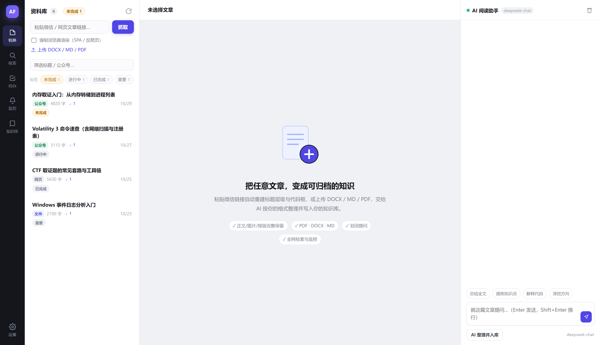
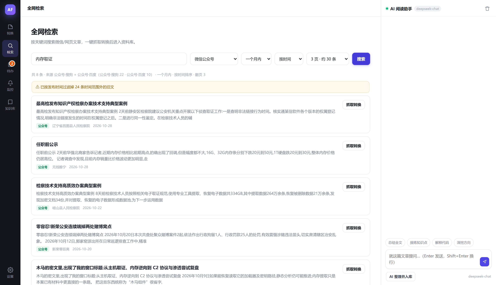
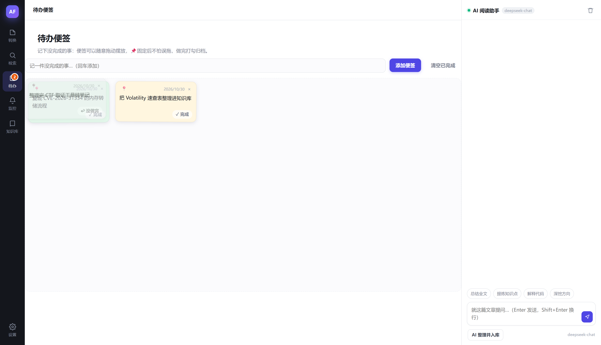
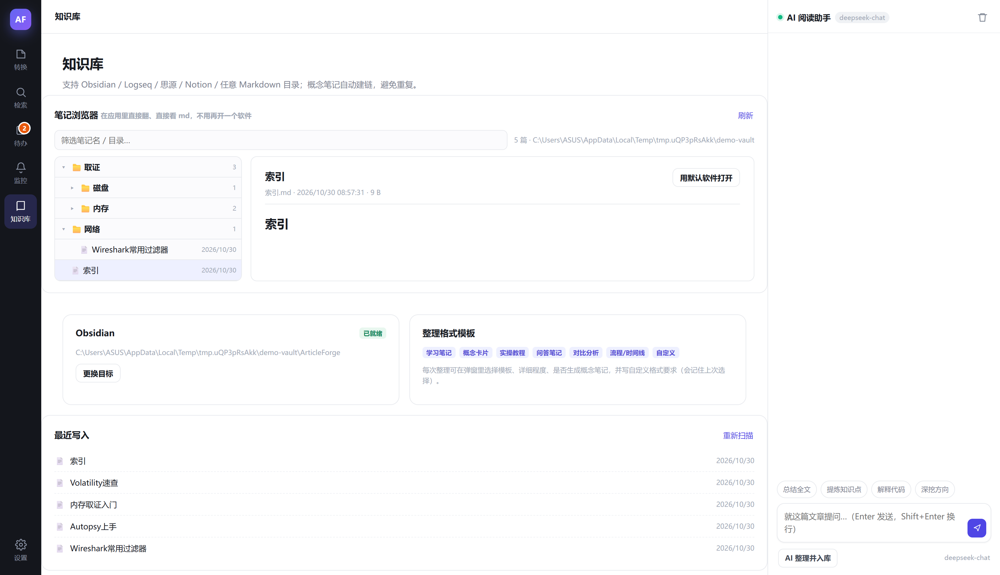

# ArticleForge

将网页、微信公众号文章与本地文档转换为 Markdown、Word 或 PDF，并通过 AI 整理为知识笔记写入本地知识库；同时提供多源检索与关键词监控。

Windows 桌面应用，基于 Electron 与 Node.js。除调用用户自行配置的 AI 服务外，全部处理与数据均留在本机。

[](https://github.com/ilovezerotwo02/ArticleForge/releases/latest)
[](LICENSE)
[](https://github.com/ilovezerotwo02/ArticleForge/releases/latest)
[](https://www.electronjs.org/)



[English](README.en.md)

## 概述

保存一篇文章只是第一步，将其整理进个人知识体系才是主要成本。本项目把该过程拆成四个可以独立使用的环节：

```
链接 / 本地文档
  └─ 正文抽取（去除广告、图片本地化、公式保留）
      └─ 阅读与导出（Markdown / Word / PDF）
          └─ AI 整理（知识点抽取、关联建立）
              └─ 写入知识库（目录自动归类，预览后落盘）
```

文章、聊天记录与设置存放于 `%APPDATA%\articleforge\data`；API Key 仅写入本机配置文件，请求只发往用户指定的 AI 服务商。

## 功能

### 内容转换与导出

- 输入：网页链接、微信公众号文章，或本地 PDF / DOCX / HTML / TXT / Markdown 文件
- 正文抽取基于 Readability，按节点清洗；站内图片下载至本地并改写路径，导出文件可离线查看
- 阅读视图提供大纲导航，Markdown 视图可查看源码

| 输出格式 | 说明 |
|---|---|
| Markdown | 带 frontmatter 与围栏代码块 |
| Word | 带大纲层级与底纹代码框 |
| PDF | A4 分页 |

### 知识库

- 适配 Obsidian（直接写入 vault 目录）、Logseq、任意 Markdown 目录、思源笔记（API）与 Notion（API）
- 两种组织方式：单文件（知识点与关联内联），或多文件（概念单独成卡，带双链与索引）
- 应用内提供知识库目录树，可按目录展开、按笔记名筛选，点开即为渲染后的正文；右侧标题目录支持跳转，并在滚动时高亮当前小节
- 每篇文章可添加自定义标签，资料库顶部支持按标签筛选；标题栏常驻「未完成」计数，用于过滤未读完或未处理的内容

### AI 整理与入库

- 兼容任何 OpenAI 格式接口，DeepSeek、Kimi、OpenAI 及本地模型均可接入
- 整理前可选择模板、详细程度与知识点数量上限，也可自定义格式要求，后者优先级最高
- 目录自动归类：读取知识库完整目录树（不限层数），每个目录附带现有笔记名作为判断依据；AI 给出目标目录与理由，服务端校验路径合法性，避免生成不存在的路径
- 目标目录已存在同主题笔记时，默认以分隔线与带日期标题追加至该笔记末尾，不改动原有内容；预览中可改为新建文件
- 整理结果、目标路径与写入方式均在预览中确认后才写入磁盘

### 检索

微信公众号与网页检索在同一次查询中并行执行，结果合并去重后按相关度或时间排序。

| 来源 | 说明 |
|---|---|
| 搜狗微信 | 单关键词最多 10 页，约 100 条 |
| 百度 `site:mp.weixin.qq.com` | 直接返回真实 `mp.weixin.qq.com` 地址与发布日期 |
| Bing `site:mp.weixin.qq.com` | 收录通常较新，已收紧为仅保留真实公众号链接 |
| 公众号 RSS（wechat2rss） | 实时推送，不受搜索引擎收录延迟影响 |
| Bing 资讯 RSS | 免验证码实时源，自带发布日期 |
| GitHub、NVD、CISA KEV、Exploit-DB、MITRE CVE | 安全情报，均走官方 API |
| 安全客、先知、FreeBuf、知道创宇、绿盟、The Hacker News、BleepingComputer | 安全社区，走官方 RSS |

- 时间范围可选 24 小时至一年，排序可选相关度或时间；按时间排序时百度附带收录时间窗，Bing 附带时间过滤参数
- 相关度排序综合标题、摘要与公众号名的分词命中、整句命中以及新鲜度加权
- 查询包含安全类关键词时，「全部来源」会自动并入安全情报源
- 每个来源均可翻页，翻页数可选 2 / 3 / 5 / 8 / 10 页，单次结果上限 200 条
- 发布日期从结果中实际解析；无法解析日期的结果在时间排序中置于末尾，不参与「最新」判定

### 关键词监控

- 来源可选全网、公众号、网页或安全情报
- 命中结果按关键词匹配、来源权重与新鲜度打分排序，跨来源重复报道按标题相似度去重
- 命中可推送至钉钉（支持加签）、飞书、企业微信、Telegram 或自定义 JSON 接口
- 每个任务自动生成监控日报 Markdown，默认写入知识库的「监控」目录，可直接在 Obsidian 或 Typora 中阅读与编辑
- 来源被限流时自动熔断并按指数退避，同类请求串行化并加入随机抖动

### AI 阅读侧栏

- 支持划词提问与连续追问，回答标注原文位置
- 渲染 KaTeX 公式与 Markdown 表格，兼容 Obsidian 的 `==高亮==` 语法，代码块可复制

### 界面

- 待办便签：独立页面记录未完成事项，便签可拖动至窗口任意位置并跨页面常驻显示，支持固定与完成后归档
- 自定义背景：可上传图片作为应用背景，遮暗、模糊、面板浓度、饱和度与填充方式五项参数可实时调整，正文阅读区同步适配
- 侧栏可收起：资料库栏与 AI 栏可一键收起，收起后由窗口边缘的拉手唤回，状态自动记忆

<table>
<tr>
<td width="33%" align="center"><b>多源检索</b><br></td>
<td width="33%" align="center"><b>待办便签</b><br></td>
<td width="33%" align="center"><b>知识库目录树</b><br></td>
</tr>
</table>

## 安装

下载 [Releases](https://github.com/ilovezerotwo02/ArticleForge/releases/latest) 中的安装包：

| 文件 | 说明 |
|---|---|
| `ArticleForge-1.0.7-setup.exe` | 安装版，安装后生成桌面快捷方式 |
| `ArticleForge-1.0.7-portable.exe` | 便携版，双击运行，无需安装 |

数据存放于 `%APPDATA%\articleforge\data`，卸载时删除程序与该目录即可。安装包未做代码签名，首次运行若被 SmartScreen 拦截，选择「更多信息 → 仍要运行」；也可从源码运行。

## 从源码运行

需要 Node.js 18 或更高版本。

```bash
git clone https://github.com/ilovezerotwo02/ArticleForge.git
cd ArticleForge
npm install
npm run vendor   # 将 marked 与 KaTeX 复制到 public/vendor
npm start        # 浏览器访问 http://127.0.0.1:5178
```

桌面模式：

```bash
npm run app
```

`npm run vendor` 不是可选步骤。electron-builder 会裁剪未被直接 import 的依赖（KaTeX 曾因此缺失），因此 marked 与 KaTeX 统一放在 `public/vendor`，由脚本从 node_modules 复制。

## 打包

```bash
npm run vendor
npm run icon         # 修改 build/icon.png 后重新生成图标
npm run build:dir    # 绿色版目录 → release/win-unpacked
npm run build        # 便携版 → release/ArticleForge-1.0.7-portable.exe
npm run build:installer  # 安装版 → release/ArticleForge-1.0.7-setup.exe
```

## 使用流程

1. 配置 AI：设置 → AI 模型，填写接口地址、Key 与模型名。未配置时转换与导出仍可用，仅整理入库不可用。
2. 配置知识库：设置 → 知识库，选择 Obsidian 并指定 vault 路径，或选择任意 Markdown 目录。保存后应用会读取目录树用于归类。
3. 获取内容：粘贴链接抓取，或上传本地文件。
4. 整理入库：点击「AI 整理并入库」，预览确认后写入。
5. 配置监控：在监控页添加关键词与检查周期，命中结果可一键转入知识库。

## 目录结构

```
├── server.js            Express 服务与 API 路由
├── electron/            主进程（窗口、托盘、数据目录迁移）
├── src/
│   ├── config.js        设置读写与默认值
│   ├── extract.js       正文抽取与清洗
│   ├── render.js        阅读页 / 导出页渲染
│   ├── ai.js            AI 客户端、整理、目录树判断、合并目标判断
│   ├── search.js        多源检索、公众号链接解析
│   ├── intel.js         免验证码情报源聚合
│   ├── health.js        来源健康度熔断（指数退避、冷却跳过）
│   ├── util.js          日期解析、标题相似度等共享工具
│   ├── watch.js         关键词监控（打分、去重、Webhook、Markdown 日报）
│   ├── exporter.js      Markdown / DOCX / PDF 导出
│   └── kb/              知识库适配器（Obsidian / Logseq / 目录 / 思源 / Notion）
├── public/              前端资源，vendor 下为 marked 与 KaTeX
├── scripts/             vendor 同步、图标生成、冒烟测试等辅助脚本
└── data/                运行数据（不入库，首次启动自动创建）
```

## 已知限制

- 免费检索源的可用性受出口 IP 影响：DuckDuckGo 在国内多数网络不可达（已自动熔断跳过），搜狗与百度在连续请求后会要求验证码。填写 Tavily Key 可提高稳定性。
- 情报源中的 Google News、Reddit、Hacker News 在国内网络无法直连，会自动熔断跳过，配置代理后恢复。
- 公众号检索依赖搜狗、百度与 Bing 的公开索引，覆盖面小于微信内置搜索，且存在收录延迟（搜狗以天计，百度以月计）。需要最新内容时建议配置 wechat2rss。
- 搜狗用于按时间筛选的参数已被官方忽略，时间排序由本地解析发布日期后重排完成；无法解析日期的结果排在末尾。
- 360 结果页不提供发布日期，此类结果在时间过滤时标记为「日期未标注」。
- GitHub 搜索匿名额度为每分钟 10 次，NVD 无 Key 时为每 30 秒 5 次。监控任务较多时建议在设置中填写 GitHub Token 与 NVD Key。
- 整理质量取决于所选模型。JSON 输出异常时会自动纠错重试，仍失败则退化为纯文本保存，不会丢失内容。

## 反馈

问题与功能建议请提交 [Issue](https://github.com/ilovezerotwo02/ArticleForge/issues)。提交时请附上系统版本、应用版本与相关日志，便于定位。

## 许可

[MIT](LICENSE)
